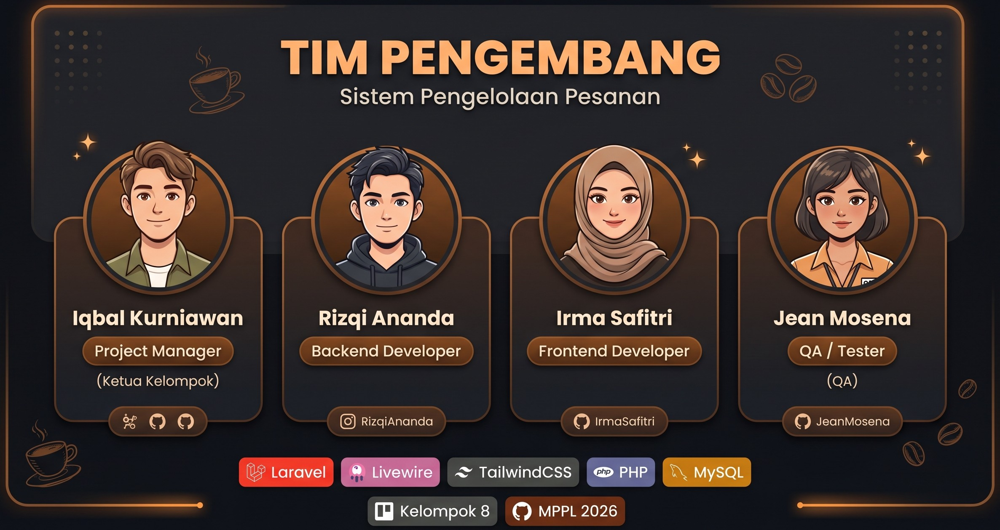

<!-- Banner Utama -->

  

# Kelompok 8 - Sistem Pengelolaan Pesanan pada UMKM Warung Kopi

Mata kuliah Manajemen Proyek Perangkat Lunak (MPPL).

## 📌 Project Overview
Proyek ini bertujuan untuk mengembangkan sistem yang membantu kasir dalam mencatat dan mengelola pesanan pelanggan, menghitung total pembayaran, memantau status pesanan, serta menyimpan riwayat transaksi.

---

## 👥 Tim Pengembang

  

| Nama | Peran |
| :--- | :--- |
| **Iqbal Kurniawan** | Project Manager / Ketua Kelompok |
| **Rizqi Ananda** | Developer (Backend & Database) |
| **Irma Safitri** | Developer (Frontend / UI) |
| **Jean Mosena** | Developer (Tester / QA) |
- [ ] Sprint 2 — Requirements & Design
- [ ] Sprint 3 — Development
- [ ] Sprint 4 — Testing & Finalization

