<!-- Header Logo MR. COFFEE -->

  

<!-- Banner Animasi Utama (SVG) -->

  

<h1 align="center">☕ Sistem Pengelolaan Pesanan pada UMKM Warung Kopi</h1>

  <b>Mata Kuliah:</b> Manajemen Proyek Perangkat Lunak (MPPL) &nbsp;|&nbsp; 
  <b>Kelompok:</b> 8 &nbsp;|&nbsp; 
  <b>Tahun:</b> 2026

  
  
  
  

---

## 📌 Latar Belakang & Permasalahan

Warung kopi merupakan salah satu jenis UMKM yang memiliki aktivitas transaksi cukup tinggi, terutama pada saat jam ramai. Dalam prosesnya, pelanggan menyampaikan pesanan kepada kasir, kemudian kasir mencatat pesanan secara manual sebelum diteruskan kepada bagian yang menyiapkan pesanan.

Proses pencatatan secara manual ini menimbulkan beberapa kendala:
* ❌ **Pencatatan Manual:** Rentan terjadi kesalahan catat atau pesanan tertukar saat kondisi warung ramai.
* ❌ **Monitoring Terbatas:** Kasir kesulitan memantau status pesanan yang sedang diproses.
* ❌ **Perhitungan Lambat:** Perhitungan total pembayaran masih dilakukan secara manual.
* ❌ **Arsip Tidak Terstruktur:** Riwayat transaksi belum tersimpan secara rapi dan terorganisir.

---

## 🎯 Tujuan Proyek

1. Membantu kasir dalam mencatat pesanan pelanggan secara cepat dan presisi.
2. Mengurangi risiko kesalahan pencatatan dan pesanan tertukar.
3. Mempermudah proses perhitungan total pembayaran secara otomatis.
4. Membantu kasir memantau status pesanan secara *real-time* (*Menunggu*, *Diproses*, *Selesai*).
5. Menyimpan data transaksi secara terstruktur untuk melihat riwayat dan laporan penjualan sederhana.

---

## 🔄 Alur Sistem (Workflow)
## 🎯 Ruang Lingkup Proyek (Scope)

| 🟢 IN SCOPE | 🔴 OUT OF SCOPE |
| :--- | :--- |
| Pendataan menu & harga warung kopi | Pemesanan langsung melalui HP pelanggan |
| Login pengguna / kasir | Sistem QR code untuk pemesanan |
| Input & jumlah pesanan pelanggan oleh kasir | Layanan pesan antar / *delivery* |
| Perhitungan total & pencatatan pembayaran otomatis | Pembayaran online otomatis (e-wallet / payment gateway) |
| Pengelolaan status pesanan (*Menunggu*, *Diproses*, *Selesai*) | Pengelolaan stok bahan baku & gaji karyawan |
| Penyimpanan & riwayat data transaksi | Sistem *membership* / poin pelanggan |
| Laporan penjualan sederhana | Pengelolaan promosi dan pemasaran |

---

## 👥 Tim Pengembang (Kelompok 8)

<!-- Banner Tim Pengembang -->

  

| ID | Nama | Peran | Kategori | Interest | Influence |
| :-: | :--- | :--- | :-: | :-: | :-: |
| **S01** | **Iqbal Kurniawan** | Project Manager / Ketua Kelompok | Internal | High | High |
| **S02** | **Rizqi Ananda** | Developer (Backend & Database) | Internal | High | Medium |
| **S03** | **Irma Safitri** | Developer (Frontend / UI) | Internal | High | Medium |
| **S04** | **Jean Mosena** | Developer (Tester / QA) | Internal | High | Medium |

---

## 🤝 Stakeholder Eksternal

| ID | Stakeholder | Peran / Jabatan | Kategori | Interest | Influence |
| :-: | :--- | :--- | :-: | :-: | :-: |
| **S05** | Bpk Supriyanto | Pemilik Proyek / Klien (Sponsor) | Eksternal / Bisnis | High | High |
| **S06** | Kasir Warung Kopi | Pengguna Utama Sistem | Eksternal / Pengguna | High | Medium |
| **S07** | Waiter / Pembuat Pesanan | Penerima & Pemroses Pesanan | Eksternal / Pengguna | High | High |
| **S08** | Buk Cut Alna | Supervisor / Evaluator Proyek | Eksternal / Akademik | High | High |

---

## 🌲 Work Breakdown Structure (WBS)

## 📅 Jadwal Pelaksanaan Proyek

| No | Kategori Pekerjaan (WBS) | Pekan Pelaksanaan |
| :-: | :--- | :-: |
| **1.0** | Manajemen & Perencanaan Proyek | Pekan 1 |
| **2.0** | Perancangan Sistem & Desain | Pekan 2 |
| **3.0** | Pengembangan Sistem (Coding) | Pekan 3 |
| **4.0** | Pengujian Sistem (Testing & Evaluation) | Pekan 4 |
| **5.0** | Penyelesaian & Dokumentasi | Pekan 4 |

---

  <i>Dikembangkan oleh <b>Kelompok 8 - MPPL 2026</b></i>

