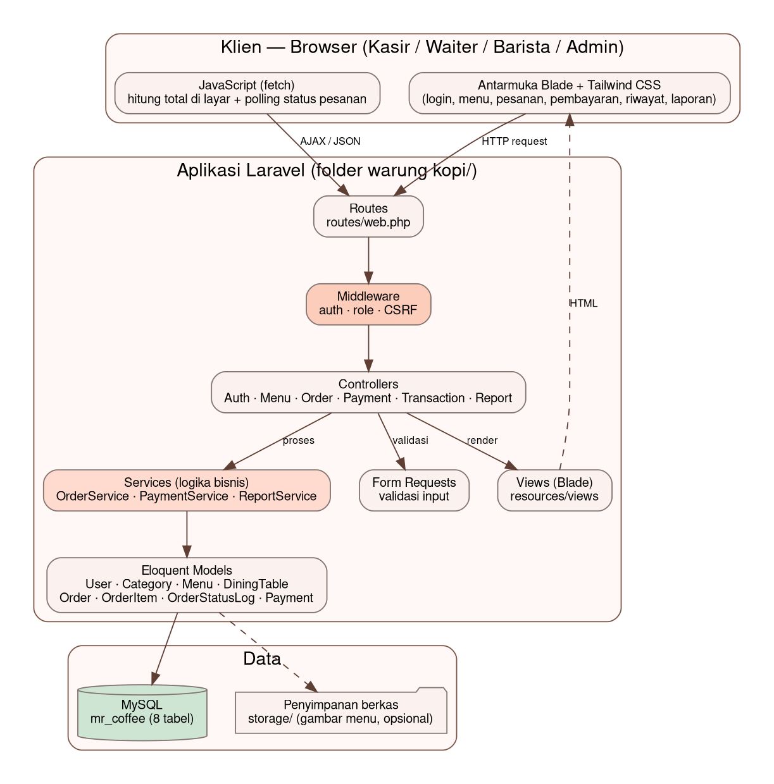
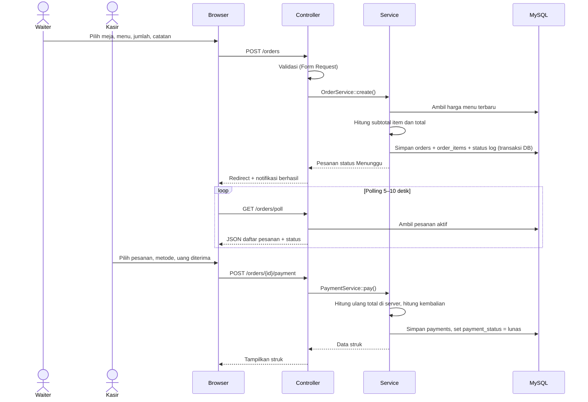
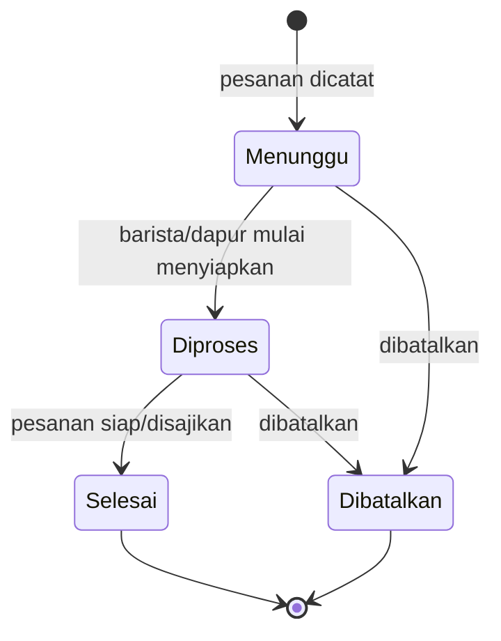
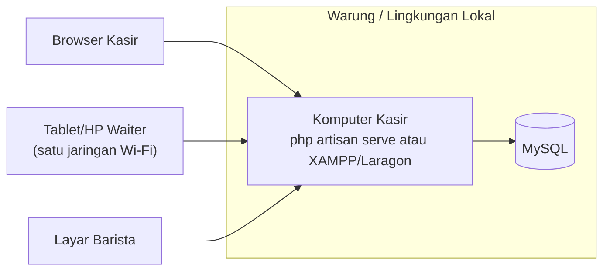

# Arsitektur Sistem

| | |
|---|---|
| **Proyek** | Sistem Pengelolaan Pesanan UMKM Warung Kopi — MR. COFFEE |
| **Tugas Jira** | MSP-12 — Merancang arsitektur sistem |
| **PIC** | Rizqi Ananda (Backend) |
| **Sprint** | 2 — Perancangan |
| **Tanggal penyusunan** | 23 Oktober 2026 |
| **Status** | Draf untuk direview tim |

## 1. Gambaran umum

Sistem berupa **aplikasi web monolit berbasis Laravel (pola MVC)** yang dijalankan di komputer kasir dan diakses lewat browser oleh kasir, waiter, barista, dan admin. Logika bisnis dipisahkan ke lapisan *service* agar controller tetap ringan dan perhitungan mudah diuji.

| Komponen | Pilihan | Alasan |
|---|---|---|
| Framework | PHP 8.x + Laravel (cek versi pasti di `composer.json` folder `warung kopi/`) | Sesuai `implementation_plan.md`; migration, Eloquent, dan auth sudah tersedia |
| Tampilan | Blade + Tailwind CSS + JavaScript | Mockup UI/UX sudah berbasis Tailwind |
| Basis data | MySQL (lihat `docs/Sprint-02/erd/`) | Data relasional: pesanan, item, pembayaran |
| Autentikasi | Session bawaan Laravel + middleware | Sesuai Charter (login kasir, proteksi akses) |
| Pembaruan status | *Polling* AJAX berkala (mis. 5–10 detik) | Cukup untuk "real-time" skala satu warung; tanpa WebSocket |
| Pembayaran | Pencatatan saja | Charter: bukan payment gateway |

## 2. Diagram arsitektur



## 3. Tanggung jawab tiap lapisan

| Lapisan | Lokasi | Tanggung jawab |
|---|---|---|
| Routes | `routes/web.php` | Memetakan URL ke controller, mengelompokkan route per peran |
| Middleware | `app/Http/Middleware` | `auth` (wajib login), `role` (batasi akses per peran), CSRF |
| Controller | `app/Http/Controllers` | Menerima request, memanggil service, memilih view/JSON |
| Form Request | `app/Http/Requests` | Validasi input (harga ≥ 0, qty ≥ 1, menu tersedia, dsb.) |
| Service | `app/Services` | Logika bisnis: hitung total, ubah status, proses pembayaran, rekap laporan |
| Model | `app/Models` | Eloquent + relasi antartabel |
| View | `resources/views` | Halaman Blade; implementasi mockup UI/UX |

## 4. Struktur folder aplikasi (rencana)

```text
warung kopi/
├── app/
│   ├── Http/
│   │   ├── Controllers/
│   │   │   ├── AuthController.php
│   │   │   ├── DashboardController.php
│   │   │   ├── MenuController.php
│   │   │   ├── OrderController.php
│   │   │   ├── PaymentController.php
│   │   │   ├── TransactionController.php
│   │   │   └── ReportController.php
│   │   ├── Middleware/EnsureRole.php
│   │   └── Requests/ (StoreMenuRequest, StoreOrderRequest, StorePaymentRequest)
│   ├── Models/ (User, Category, Menu, DiningTable, Order, OrderItem, OrderStatusLog, Payment)
│   └── Services/ (OrderService, PaymentService, ReportService)
├── database/ (migrations, seeders)
├── resources/views/ (layouts, auth, menus, orders, payments, transactions, reports)
└── routes/web.php
```

## 5. Rancangan route

| Method | URL | Controller@aksi | Peran | User story |
|---|---|---|---|---|
| GET / POST | `/login` | `AuthController@showLogin / login` | Publik | US-01 |
| POST | `/logout` | `AuthController@logout` | Semua | US-01 |
| GET | `/dashboard` | `DashboardController@index` | Semua | US-01 |
| GET | `/menus` | `MenuController@index` | Admin, Kasir | US-02 |
| POST / PUT / DELETE | `/menus`, `/menus/{menu}` | `MenuController@store / update / destroy` | Admin, Kasir | US-02 |
| GET | `/orders` | `OrderController@index` | Semua | US-05 |
| GET | `/orders/create` | `OrderController@create` | Waiter, Kasir | US-03 |
| POST | `/orders` | `OrderController@store` | Waiter, Kasir | US-03 |
| GET | `/orders/{order}` | `OrderController@show` | Semua | US-05 |
| PATCH | `/orders/{order}/status` | `OrderController@updateStatus` | Barista, Waiter, Kasir | US-05 |
| GET | `/orders/poll` | `OrderController@poll` (JSON) | Semua | US-05 |
| GET | `/payments` | `PaymentController@index` | Kasir | US-04 |
| POST | `/orders/{order}/payment` | `PaymentController@store` | Kasir | US-04 |
| GET | `/payments/{payment}/receipt` | `PaymentController@receipt` | Kasir | US-04 |
| GET | `/transactions` | `TransactionController@index` | Kasir, Admin | US-06 |
| GET | `/reports/sales` | `ReportController@sales` | Kasir, Admin | US-06 |

Matriks peran di atas adalah usulan; sesuaikan setelah tim memutuskan peran mana yang dipakai pada MVP.

## 6. Alur utama: membuat pesanan dan membayar



**Prinsip penting:** total dan kembalian **selalu dihitung ulang di server**. Hitungan di JavaScript hanya untuk tampilan agar tidak dapat dimanipulasi dari browser.

## 7. Siklus status pesanan



Setiap perubahan status ditulis ke `order_status_logs`. Aturan: status tidak boleh mundur atau melompat dari `Menunggu` langsung ke `Selesai`; pesanan `Selesai`/`Dibatalkan` tidak dapat diubah lagi.

## 8. Rancangan penerapan (deployment)



Untuk tugas ini cukup dijalankan **lokal** pada jaringan Wi-Fi yang sama. Hosting publik tidak diwajibkan oleh Charter; jika dipakai kelak, gunakan HTTPS.

## 9. Penyelarasan dengan ERD dan mockup

**Dengan ERD (Jean)**
- Delapan model sama persis dengan delapan tabel domain di ERD. Laravel juga membuat tabel bawaan (`sessions`, `cache`, `jobs`, dan sejenisnya), yang tidak termasuk ERD.
- Login memakai kolom **`username`**, bukan `email` bawaan Laravel. Migration `users` bawaan (hasil setup Iqbal) harus diubah mengikuti ERD, dan `AuthController` memakai `Auth::attempt(['username' => ..., 'password' => ..., 'is_active' => 1])`.
- `OrderService` juga memegang `updateStatus()` dan `cancel()`, yang menulis ke `order_status_logs`. `PaymentService::pay()` mengisi `payments` dan `orders.payment_status`.
- `payments.status = void` ada di ERD, tetapi belum ada route atau fitur void pada MVP.

**Dengan mockup (Irma)**
- Sidebar mockup sama untuk semua pengguna. Karena akses dibatasi per peran, menu sidebar harus **ditampilkan sesuai peran** (mis. `@can` atau pengecekan `role`).
- Menu "Pesanan Masuk" pada sidebar dilayani route `/orders?status=menunggu`; "Daftar Pesanan" memakai `/orders`.
- Mockup **belum memiliki halaman kelola menu** (US-02, MSP-23). Halaman ini perlu dibuat.
- Mockup menampilkan fitur di luar MVP: rekonsiliasi kas, shift, status kebersihan meja, "Simpan Sementara", dan verifikasi QRIS otomatis (webhook). Implementasi mengikuti Charter: pembayaran hanya dicatat, QRIS dikonfirmasi manual oleh kasir.

## 10. Keamanan dan kualitas

- Password disimpan sebagai hash bcrypt; `.env` tidak boleh masuk repository.
- Semua form memakai token CSRF; query lewat Eloquent/parameter untuk mencegah SQL injection.
- Akses halaman dibatasi middleware `auth` dan `role`.
- Operasi pesanan + item + log dibungkus `DB::transaction()` agar data tidak setengah tersimpan.
- Harga pada `order_items` disalin dari menu (snapshot) sehingga transaksi lama tidak berubah.
- Pengujian utama: perhitungan total/kembalian, alur status, dan pembatasan akses (diteruskan ke Test Plan oleh Jean).

## 11. Hal yang perlu diputuskan tim

- **Mekanisme "real-time":** polling (rekomendasi, paling sederhana) atau Laravel Reverb/WebSocket (lebih rumit, belum perlu untuk MVP).
- **Peran pengguna pada MVP:** hanya Kasir dan Admin, atau juga Waiter dan Barista seperti pada mockup.
- **Lokasi kode:** Jira menyebut asumsi `src/`, sedangkan aplikasi sebenarnya berada di `warung kopi/`. Dokumen ini mengikuti `warung kopi/`; perbarui deskripsi Jira.
- **Fitur mockup di luar user story** (rekonsiliasi kas, integrasi QRIS/EDC otomatis, status kebersihan meja) ditunda ke iterasi berikutnya.
